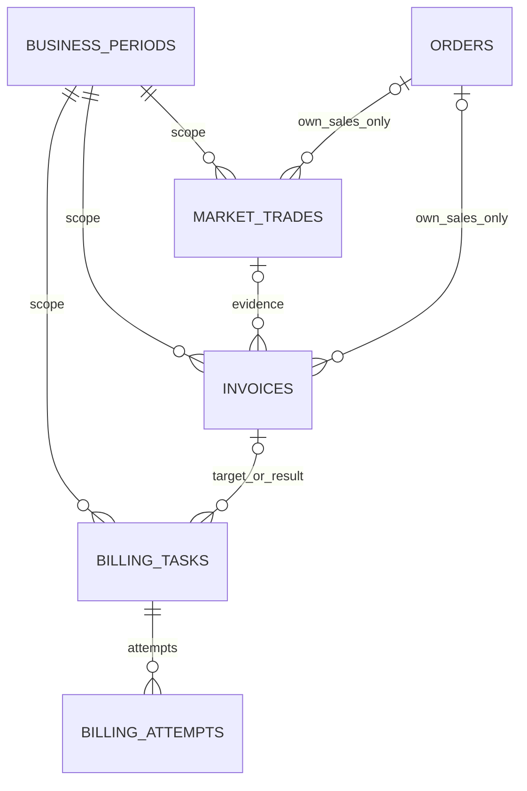

# Entrega 3 — Paso 2: modelo financiero y operaciones durables

Este paso extiende la persistencia existente. No ejecuta SOAP, compras, ventas, pagos ni llamadas al gateway; los workers financieros se implementan en pasos posteriores. Las preguntas C1/C2 del [paso 1](ENTREGA3_PASO1.md) siguen abiertas.

## Entidades incorporadas

| Entidad | Responsabilidad | Restricciones principales |
| --- | --- | --- |
| `BusinessPeriod` | Separar ambiente, grupo y época contable; fechas de inicio/cierre | Único por ambiente/código/grupo; grupo positivo y rango temporal válido |
| `Invoice` | Snapshot oficial de factura: ID, lado, contraparte, canal, principal, interés, total, estado y fechas | Identidad y referencia de OC únicas por período; importes finitos no negativos; enlaces comerciales del mismo período |
| `BillingTask` | Una emisión para una OC o un pago de una factura, con estado, error y próxima revisión | Claves naturales únicas por período/tipo/objetivo; destino obligatorio; confirmación con fecha y factura conocida |
| `BillingAttempt` | Cada intento durable, antes de enviar y después de confirmar o perder el resultado | Número único por tarea; un solo intento en vuelo; fechas y estado coherentes; respuesta estructurada opcional |
| `MarketTrade` | Referencia de un cierre confirmado: oferta, OC, rol propio, contraparte, SKU, cantidad y precio | Oferta/OC únicas por período; cantidad positiva; precio decimal finito; una compra no enlaza una venta local |



No se crea otro inventario ni se modifica la identidad de lotes/unidades. `MarketTrade` conserva la contraparte de la operación; eso es distinto de `Lot.origin`. Las reservas de ofertas abiertas y la asociación de unidades transferidas corresponden al paso 9; este modelo no pretende tenerlas implementadas.

## Compra, venta y facturas

- `InvoiceSide.CLIENT` significa costo/deuda del grupo; `SUPPLIER`, factura emitida por el grupo. `PENDING` y `PAID` son estados oficiales, separados del estado de una tarea local.
- `MarketRole.BUYER` registra una compra sin convertirla en `Order` de venta. El ingreso de órdenes sigue exigiendo que el grupo sea proveedor; esa protección no se eliminó para permitir compras.
- `MarketRole.SELLER` puede enlazar una venta local. Se añadió `OrderSource.MARKET` para esa representación futura, preservando las fuentes anteriores.
- `Invoice.external_order_id`, `sale_order_id` y `market_trade_id` son opcionales. Una factura puede observarse sin saber aún qué OC corresponde; el modelo no inventa ese vínculo por monto/fecha ni obliga a crear una OC ficticia para un costo de fábrica o pulmón.
- Los enlaces factura–operación y tarea–factura usan FK compuestas con `period_id`; tampoco asignar una relación ORM puede cambiar silenciosamente el período del hijo para hacerla coincidir.
- La futura integración debe comprobar los hechos oficiales: grupo emisor/receptor, correspondencia exacta de OC/oferta, lado correcto antes de pagar, coherencia de importes y rol de la contraparte. Las FK y enums no sustituyen esas verificaciones de negocio.

## Tareas e intentos recuperables

Las claves para buscar o crear una tarea idempotente son:

- Emisión: `(period_id, EMIT_INVOICE, external_order_id)`.
- Pago: `(period_id, PAY_INVOICE, invoice_id)`.

El UUID de la tarea identifica el mismo trabajo durante toda su recuperación. `invoice_id` es el objetivo de un pago; en una emisión inicialmente puede faltar y pasa a ser el resultado conocido después de conciliar la factura.

Estados disponibles:

```text
READY -> IN_FLIGHT -> CONFIRMED
                  -> UNCERTAIN -> conciliación oficial
                  -> FAILED    -> revisión/reintento según next_retry_at
```

El código futuro debe persistir tarea/intento en `IN_FLIGHT` **antes** de enviar. Si un proceso muere allí, no debe asumir que el servicio remoto no recibió la operación. Los intentos conservan número, inicio/fin, tipo de error, estado HTTP y respuesta estructurada; no almacenar headers WS-Security ni credenciales en esa respuesta.

`UNCERTAIN` representa un resultado desconocido y sobrevive al reinicio de la sesión. No es autorización para repetir un POST. La restricción parcial de un intento en vuelo y las claves únicas impiden duplicar filas concurrentes, pero **no prueban por sí solas exactamente un efecto externo**. La conciliación y las garantías SOAP se implementarán en pasos 3–6, después de confirmar los puntos contractuales del paso 1.

## Dinero y compatibilidad E1/E2

- `orders.total` y `order_items.unit_price` pasan de `INTEGER` a `NUMERIC` sin imponer una escala que redondee los datos. Facturas y operaciones de mercado usan también `NUMERIC`, mapeado a `Decimal`.
- El ingreso de OC conserva el precio decimal oficial y calcula el total sin convertir el precio a `int`. Sigue rechazando órdenes de otro proveedor.
- El JSON de importes enteros continúa siendo un número entero, como antes. Un importe fraccionario nuevo se serializa como **string decimal exacto**; ejemplos: `"1.123456789"` y `"3.370370367"`. No se convierte a float para presentarlo.
- `Payment.amount` y los esquemas de checkout conservan su contrato entero. Para una orden con total íntegro, se envía un `int` real al cliente de checkout; si tiene fracción se devuelve HTTP 409 antes de llamar al checkout, sin truncar o redondear.
- No se implementa aquí la facturación del checkout ni se crean pagos SOAP a partir de sus callbacks. `Payment` y `Invoice` siguen representando servicios diferentes.

Los consumidores que incorporen nuevos importes fraccionarios deben aceptar su representación decimal; el catálogo y los importes enteros existentes del portal mantienen su formato. La precisión de entrada del servicio SOAP se revisará en el paso 3: que la DB conserve decimales no recupera precisión ya perdida por un parser float.

## Migración y reversión

Nueva revisión: `c7b4e2a91d60`, sucesora de `8c62e71f4b09`.

```bash
# Con el PostgreSQL local habitual disponible y el .env correcto:
.venv/bin/alembic upgrade head
.venv/bin/alembic current
```

La migración crea las cinco tablas y sus enums/índices, añade `MARKET` a la fuente de órdenes y convierte los dos importes existentes. No crea períodos, tareas, facturas ni operaciones por defecto; tampoco activa workers o mueve datos de E2 a E3. Debe aplicarse antes de utilizar el código con precios fraccionarios.

El downgrade al head anterior se ensayó con pedidos y pagos E1/E2 existentes. Reconstruye el enum anterior y los importes enteros sólo si es seguro. Rechaza la reversión cuando hay:

1. Datos de E3 en las tablas nuevas, incluso un período: no elimina auditoría financiera de forma silenciosa.
2. Órdenes de canal mercado.
3. Precios/totales fraccionarios o fuera del rango del `INTEGER` anterior: no redondea ni permite overflow.

Una reversión de producción con esos datos requiere respaldo/archivo y un procedimiento explícito. El comando de downgrade sólo se ejecutó en bases de ensayo. No se aplicó esta migración en el servidor ni en la base operativa local durante la implementación.

El período explícito en las tablas nuevas no filtra mágicamente las colas antiguas de E2. La estrategia de DB separada o la adaptación completa de todos los consumidores al período se mantiene como tarea del arranque E3 descrito en el paso 1.

## Validación

**869 pruebas aprobadas** en la suite completa, incluidas 41 pruebas nuevas del paso 2. Ruff y formato correctos. Se incluyen pruebas con PostgreSQL real aislado para:

- Facturas por ambos lados, decimales de nueve posiciones, IDs duplicados y rechazo de valores negativos, NaN o infinitos.
- Compra sin una venta local, precio decimal de mercado y rechazo de enlaces comerciales cruzados entre períodos.
- Emisión/pago con objetivos únicos; dos workers compitiendo por la misma tarea; un único intento en vuelo y recuperación de un resultado incierto después de cerrar/abrir sesiones.
- Upgrade/downgrade con pedidos web, OC externas y pagos anteriores; equivalencia entre migración y metadata actual; rollback bloqueado cuando perdería datos, precisión o capacidad de representar una orden de mercado.
- Lectura HTTP exacta de precios fraccionarios en las cuatro fuentes externas y contrato entero del checkout cargando importes desde PostgreSQL.
- Regresiones existentes E1/E2, incluida la migración histórica E2, cuya comparación conserva el tipo `INTEGER` que existía en esa revisión.

Estas pruebas bloquean conexiones externas y no consumen gateway ni ejecutan operaciones del curso. Los resultados finales están en [ENTREGA3_PASO2_EVIDENCIA.json](ENTREGA3_PASO2_EVIDENCIA.json).
